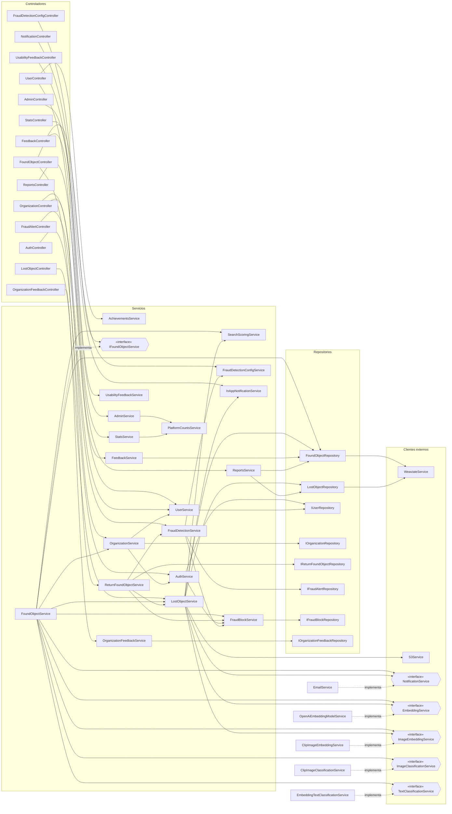

# Diagrama de clases — EurekApp (EU-421)

Generado a partir de `Backend/src/main/java/com/eurekapp/backend` (estado de `main`). Son dos vistas del mismo código,
porque en un solo diagrama las ~80 clases no se leen:

1. **Modelo de dominio:** entidades, enums y objetos de valor, con sus relaciones.
2. **Capas:** controladores → servicios → repositorios y clientes externos, con las dependencias principales.

Convenciones: `+` público, `-` privado. Los getters/setters de Lombok (`@Data`, `@Builder`) no se dibujan.
Las clases marcadas `<<Weaviate>>` no son entidades JPA: se persisten en la base vectorial.

## 1. Modelo de dominio

```mermaid
classDiagram
    direction LR

    class UserEurekapp {
        <<Entity>>
        -Long id
        -String username
        -String password
        -boolean active
        -String firstName
        -String lastName
        -Role role
        -Long XP
        -Long returnedObjects
        -String providerType
        -String providerId
        -String passwordResetToken
        -LocalDateTime passwordResetTokenExpiry
        -LocalDateTime fraudAlertsSeenAt
        +getAuthorities() Collection
        +isAccountNonLocked() boolean
        +isEnabled() boolean
    }
    class UserDetails {
        <<interface>>
    }
    class Organization {
        <<Entity>>
        -Long id
        -String name
        -String contactData
        -String street
        -String streetNumber
        -String city
        -String province
        -String country
        -OrganizationType organizationType
        -boolean active
    }
    class GeoCoordinates {
        <<Embeddable>>
        -Double latitude
        -Double longitude
    }
    class OrganizationPolicy {
        <<Entity>>
        -Long id
        -Integer maxStorageDays
        -Boolean requiresIdentityValidation
        -Boolean requiresAdditionalEvidence
        -String additionalEvidenceDetails
        -OrganizationType organizationType
    }
    class OrganizationPolicyHistory {
        <<Entity>>
        -Long id
        -Long organizationId
        -LocalDateTime changedAt
        -String previousSnapshot
    }
    class OrganizationRequest {
        <<Entity>>
        -Long id
        -String organizationName
        -OrganizationType organizationType
        -String customOrganizationType
        -String ownerFirstName
        -String ownerLastName
        -String ownerEmail
        -String ownerPhone
        -String reason
        -OrganizationRequestStatus status
        -LocalDateTime createdAt
        -LocalDateTime resolvedAt
        -String adminNote
    }
    class AddEmployeeRequest {
        <<Entity>>
        -Long id
        -AddEmployeeRequestStatus status
    }
    class ReturnFoundObject {
        <<Entity>>
        -Long id
        -String firstName
        -String lastName
        -String DNI
        -String phoneNumber
        -String foundObjectUUID
        -String personPhotoUUID
        -LocalDateTime datetimeOfReturn
        -LocalDateTime notificationSentAt
        -String notificationRecipient
        -Long organizationId
        -String feedbackToken
    }
    class OrganizationFeedback {
        <<Entity>>
        -Long id
        -Long organizationId
        -Integer staffTreatment
        -Integer waitingTime
        -Integer instructionsClarity
        -Integer objectCondition
        -Integer pickupSecurity
        -String comment
        -LocalDateTime createdAt
    }
    class SearchFeedback {
        <<Entity>>
        -Long id
        -String organizationId
        -String foundObjectUUID
        -Integer starRating
        -Boolean wasFound
        -String comment
        -String lostObjectText
        -LocalDateTime createdAt
    }
    class UsabilityFeedback {
        <<Entity>>
        -Long id
        -Integer starRating
        -String aspects
        -String comment
        -String context
        -LocalDateTime createdAt
    }
    class InAppNotification {
        <<Entity>>
        -Long id
        -String title
        -String description
        -String type
        -boolean read
        -LocalDateTime createdAt
        -Long relatedRequestId
        -String relatedObjectUuid
        -Double matchScore
        -String relatedLostObjectUuid
    }
    class RewardExclusion {
        <<Entity>>
        -Long id
        -String foundObjectUUID
        -Role userRole
        -String reason
        -LocalDateTime excludedAt
        -String organizationId
    }
    class FraudAlert {
        <<Entity>>
        -Long id
        -String organizationId
        -String foundObjectUUID
        -String dni
        -String reason
        -String details
        -FraudAlertStatus status
        -LocalDateTime createdAt
        -LocalDateTime resolvedAt
        -String dedupKey
    }
    class FraudCaseMatch {
        <<Embeddable>>
        -FraudCaseType caseType
        -int matchedCount
    }
    class FraudBlock {
        <<Entity>>
        -Long id
        -String targetDni
        -LocalDateTime blockedAt
        -LocalDateTime expiresAt
    }
    class FraudDetectionConfig {
        <<Entity>>
        -Long id
        -int fraudThreshold
        -int fraudWindowDays
        -int blockDurationDays
    }
    class FoundObject {
        <<Weaviate>>
        -String uuid
        -List~Float~ imageEmbedding
        -List~Float~ textEmbedding
        -LocalDateTime foundDate
        -String title
        -String humanDescription
        -String organizationId
        -Boolean wasReturned
        -String category
        -Float score
    }
    class LostObject {
        <<Weaviate>>
        -String uuid
        -String description
        -String username
        -LocalDateTime lostDate
        -String organizationId
        -List~Float~ imageEmbedding
        -List~Float~ textEmbedding
        -String category
        -LostObjectStatus status
        -LocalDateTime closedDate
        -Boolean recovered
        -Boolean hasImage
        -String matchedObjectUuid
    }

    class Role {
        <<enumeration>>
        USER
        ORGANIZATION_OWNER
        ORGANIZATION_EMPLOYEE
        ENCARGADO
        ADMIN
    }
    class LostObjectStatus {
        <<enumeration>>
        ACTIVE
        PENDING_PICKUP
        RETRIEVED
        RETRIEVED_BY_OTHER
        CLOSED
    }
    class ObjectCategory {
        <<enumeration>>
        ROPA
        BILLETERA
        LLAVES
        ELECTRONICA
        OTROS
        +fromLabel(String) ObjectCategory
    }
    class OrganizationRequestStatus {
        <<enumeration>>
        PENDING_APPROVAL
        APPROVED
        REJECTED
        CANCELLED
    }
    class AddEmployeeRequestStatus {
        <<enumeration>>
        PENDING
        ACCEPTED
        DECLINED
    }
    class FraudAlertStatus {
        <<enumeration>>
        ACTIVE
        FALSE_POSITIVE
    }
    class FraudCaseType {
        <<enumeration>>
        CASE_1
        CASE_2
        CASE_3
        +getDisplayLabel() String
        +humanizeReason(String) String
    }
    class OrganizationType {
        <<enumeration>>
        UNIVERSITY
        AIRPORT
        BUS_TERMINAL
        ...32 valores
    }
    class Level {
        <<enumeration>>
        LEVEL1..LEVEL5
        +getLevel(Long) Level
        +getNextLevel(Long) Level
    }
    class ReturnedObjectsAchievement {
        <<enumeration>>
        LEVEL1..LEVEL5
        +getAchievedLevels(Long) List
        +getNextAchievement(Long) ReturnedObjectsAchievement
    }

    UserEurekapp ..|> UserDetails
    UserEurekapp "*" --> "0..1" Organization : organization
    UserEurekapp --> Role
    Organization *-- GeoCoordinates : coordinates
    Organization --> OrganizationType
    OrganizationPolicy "1" --> "1" Organization
    OrganizationPolicyHistory "*" --> "1" UserEurekapp : changedBy
    OrganizationRequest "*" --> "1" UserEurekapp : requestingUser
    OrganizationRequest "*" --> "0..1" UserEurekapp : resolvedBy
    OrganizationRequest "*" --> "0..1" Organization : organization
    OrganizationRequest *-- GeoCoordinates
    OrganizationRequest --> OrganizationRequestStatus
    AddEmployeeRequest "*" --> "1" UserEurekapp : user
    AddEmployeeRequest "*" --> "1" Organization
    AddEmployeeRequest --> AddEmployeeRequestStatus
    ReturnFoundObject "*" --> "0..1" UserEurekapp : userEurekapp
    ReturnFoundObject "*" --> "0..1" UserEurekapp : returnedByEmployee
    OrganizationFeedback "1" --> "1" ReturnFoundObject
    OrganizationFeedback "*" --> "0..1" UserEurekapp
    SearchFeedback "*" --> "0..1" UserEurekapp
    UsabilityFeedback "*" --> "0..1" UserEurekapp
    InAppNotification "*" --> "1" UserEurekapp
    RewardExclusion "*" --> "1" UserEurekapp
    RewardExclusion --> Role
    FraudAlert "*" --> "*" UserEurekapp : suspectUsers
    FraudAlert "*" --> "*" ReturnFoundObject : triggeringReturns
    FraudAlert "*" --> "0..1" UserEurekapp : returnedByEmployee
    FraudAlert "*" --> "0..1" UserEurekapp : resolvedBy
    FraudAlert *-- "*" FraudCaseMatch : caseMatches
    FraudAlert --> FraudAlertStatus
    FraudCaseMatch --> FraudCaseType
    FraudBlock "*" --> "1" FraudAlert
    FraudBlock "*" --> "0..1" UserEurekapp : targetUser
    FoundObject *-- GeoCoordinates
    FoundObject --> UserEurekapp : objectFinderUser
    LostObject *-- GeoCoordinates
    LostObject --> LostObjectStatus
    FoundObject ..> ObjectCategory : category
    LostObject ..> ObjectCategory : category
    UserEurekapp ..> Level : calcula desde XP
    UserEurekapp ..> ReturnedObjectsAchievement : desde returnedObjects
```

Vínculos **sin clave foránea** (por valor): `ReturnFoundObject.foundObjectUUID` → `FoundObject.uuid`;
`LostObject.username` → `UserEurekapp.username`; `LostObject.matchedObjectUuid` → `FoundObject.uuid`;
`*.organizationId` → `Organization.id`. Por eso aparecen punteados o sin flecha: están en bases distintas
(MySQL / Weaviate) o se guardaron como texto.

## 2. Capas: controladores, servicios, repositorios y clientes

Se muestran las dependencias principales (las inyectadas por constructor). No se dibujan los DTO ni
`CommonFunctions`, `TextNormalizer`, `OrganizationAddress` (utilitarios) ni la configuración de Spring.

Todos los servicios que envían correo dependen además de `EmailTemplateService` y `NotificationService`
(`AuthService`, `UserService`, `OrganizationService`, `AdminService`, `FraudDetectionService`,
`ReturnFoundObjectService`, `FoundObjectService`, `LostObjectService`); no se dibujan esas aristas para no saturar.

### Servicios externos

| Cliente | Implementa | Habla con |
|---|---|---|
| `OpenAiEmbeddingModelService` | `EmbeddingService` | OpenAI (`text-embedding-3-small`) |
| `ClipImageEmbeddingService` | `ImageEmbeddingService` | `clip-service` (vector de la foto) |
| `ClipImageClassificationService` | `ImageClassificationService` | `clip-service` (categoría sugerida) |
| `EmbeddingTextClassificationService` | `TextClassificationService` | categoría por texto: compara el embedding contra frases de cada categoría (usa el embedding de OpenAI) |
| `OpenAiImageDescriptionService` | `ImageDescriptionService` | OpenAI GPT-4o (sigue inyectado en `FoundObjectService`) |
| `WeaviateService` | — | Weaviate (`FoundObject`, `LostObject`) |
| `S3Service` | `ObjectStorage` | S3 / MinIO (fotos) |
| `EmailService` | `NotificationService` | Gmail SMTP |
