# DER — EurekApp (EU-422)

Generado a partir de las entidades JPA de `Backend/src/main/java/com/eurekapp/backend/model` (estado de `main`).
El esquema lo crea Hibernate con `ddl-auto: update`, sobre MySQL 8. Los tipos son los que Hibernate asigna
por defecto: `Long` → `BIGINT`, `String` sin `length` → `VARCHAR(255)`, `Integer` → `INT`, `boolean` → `BIT`/`TINYINT(1)`,
`LocalDateTime` → `DATETIME(6)`, `Double` → `DOUBLE`. Los enums se guardan como `VARCHAR` (`EnumType.STRING`).

> **Fuera del DER:** `FoundObject` y `LostObject` no están en MySQL. Viven en Weaviate (ver sección al final)
> y se vinculan con las tablas por valor (`found_object_uuid`, `organization_id`, `username`), sin clave foránea.

## Diagrama

```mermaid
erDiagram
    ORGANIZATIONS ||--o{ USERS : "emplea (organization_id)"
    ORGANIZATIONS ||--o| ORGANIZATION_POLICIES : "tiene (organization_id)"
    ORGANIZATIONS ||--o{ ORGANIZATION_REQUEST : "origina (organization_id)"
    ORGANIZATIONS ||--o{ ADD_EMPLOYEE_REQUEST : "invita (org_id)"
    USERS ||--o{ ADD_EMPLOYEE_REQUEST : "recibe (user_id)"
    USERS ||--o{ ORGANIZATION_REQUEST : "solicita (requesting_user_id)"
    USERS |o--o{ ORGANIZATION_REQUEST : "resuelve (resolved_by_user_id)"
    USERS ||--o{ ORGANIZATION_POLICY_HISTORY : "modifica (changed_by_id)"
    USERS ||--o{ IN_APP_NOTIFICATIONS : "recibe (user_id)"
    USERS |o--o{ RETURN_FOUND_OBJECTS : "retira (user_id)"
    USERS |o--o{ RETURN_FOUND_OBJECTS : "entrega (returned_by_employee_id)"
    RETURN_FOUND_OBJECTS ||--o| ORGANIZATION_FEEDBACK : "se califica (return_found_object_id)"
    USERS |o--o{ ORGANIZATION_FEEDBACK : "califica (user_id)"
    USERS |o--o{ SEARCH_FEEDBACK : "opina (user_id)"
    USERS |o--o{ USABILITY_FEEDBACK : "opina (user_id)"
    USERS ||--o{ REWARD_EXCLUSIONS : "excluido (user_id)"
    FRAUD_ALERT ||--o{ FRAUD_ALERT_SUSPECT_USER : "sospechosos (fraud_alert_id)"
    USERS ||--o{ FRAUD_ALERT_SUSPECT_USER : "es sospechoso (user_id)"
    FRAUD_ALERT ||--o{ FRAUD_ALERT_RETURN : "disparan (fraud_alert_id)"
    RETURN_FOUND_OBJECTS ||--o{ FRAUD_ALERT_RETURN : "disparó (return_found_object_id)"
    FRAUD_ALERT |o--o{ USERS : "empleado que devolvió (returned_by_employee_id)"
    FRAUD_ALERT |o--o{ USERS : "resuelta por (resolved_by_id)"
    FRAUD_ALERT ||--o{ FRAUD_ALERT_CASE : "casos detectados (fraud_alert_id)"
    FRAUD_ALERT ||--o{ FRAUD_BLOCK : "genera (fraud_alert_id)"
    USERS |o--o{ FRAUD_BLOCK : "bloqueado (target_user_id)"

    USERS {
        BIGINT id PK
        VARCHAR_100 username UK "NOT NULL, email, 3-100"
        VARCHAR_255 password "NOT NULL, min 8 (hash)"
        BIT active
        VARCHAR_50 first_name "NOT NULL"
        VARCHAR_50 last_name "NOT NULL"
        VARCHAR_255 role "NOT NULL: USER|ORGANIZATION_OWNER|ORGANIZATION_EMPLOYEE|ENCARGADO|ADMIN"
        BIGINT organization_id FK "NULL"
        BIGINT XP "NOT NULL, default 0"
        BIGINT returnedObjects "NOT NULL, default 0"
        VARCHAR_20 provider_type "NULL: GOOGLE|FACEBOOK"
        VARCHAR_255 provider_id "NULL"
        VARCHAR_10 password_reset_token "NULL"
        DATETIME password_reset_token_expiry "NULL"
        DATETIME fraud_alerts_seen_at "NULL"
    }
    ORGANIZATIONS {
        BIGINT id PK
        VARCHAR_255 name
        VARCHAR_255 contactData
        VARCHAR_255 street
        VARCHAR_255 streetNumber
        VARCHAR_255 city
        VARCHAR_255 province
        VARCHAR_255 country
        VARCHAR_50 organization_type "enum OrganizationType"
        DOUBLE latitude "embebido GeoCoordinates"
        DOUBLE longitude "embebido GeoCoordinates"
        TINYINT_1 active "NOT NULL, default 1"
    }
    ORGANIZATION_POLICIES {
        BIGINT id PK
        BIGINT organization_id FK,UK
        INT maxStorageDays
        BIT requiresIdentityValidation
        BIT requiresAdditionalEvidence
        VARCHAR_500 additionalEvidenceDetails
        VARCHAR_255 organizationType "enum OrganizationType"
    }
    ORGANIZATION_POLICY_HISTORY {
        BIGINT id PK
        BIGINT organizationId "sin FK declarada"
        DATETIME changedAt
        BIGINT changed_by_id FK
        TEXT previousSnapshot
    }
    ORGANIZATION_REQUEST {
        BIGINT id PK
        BIGINT requesting_user_id FK "NOT NULL"
        VARCHAR_200 organization_name "NOT NULL"
        VARCHAR_50 organization_type "NOT NULL, enum OrganizationType"
        VARCHAR_200 custom_organization_type "NULL"
        VARCHAR_200 street "NOT NULL"
        VARCHAR_20 street_number "NOT NULL"
        VARCHAR_100 city "NOT NULL"
        VARCHAR_100 province "NOT NULL"
        VARCHAR_100 country "NOT NULL"
        DOUBLE latitude "embebido"
        DOUBLE longitude "embebido"
        VARCHAR_100 owner_first_name "NOT NULL"
        VARCHAR_100 owner_last_name "NOT NULL"
        VARCHAR_150 owner_email "NOT NULL"
        VARCHAR_50 owner_phone "NOT NULL"
        VARCHAR_1000 reason "NOT NULL"
        VARCHAR_30 status "NOT NULL: PENDING_APPROVAL|APPROVED|REJECTED|CANCELLED"
        DATETIME created_at "NOT NULL, default CURRENT_TIMESTAMP"
        DATETIME resolved_at "NULL"
        BIGINT resolved_by_user_id FK "NULL"
        VARCHAR_1000 admin_note "NULL"
        BIGINT organization_id FK "NULL hasta aprobar"
    }
    ADD_EMPLOYEE_REQUEST {
        BIGINT id PK
        BIGINT user_id FK "NOT NULL"
        BIGINT org_id FK "NOT NULL"
        VARCHAR_255 status "NOT NULL: PENDING|ACCEPTED|DECLINED"
    }
    RETURN_FOUND_OBJECTS {
        BIGINT id PK
        BIGINT user_id FK "NULL, retirante con cuenta"
        VARCHAR_100 first_name "NULL (previas a EU-362)"
        VARCHAR_100 last_name "NULL (previas a EU-362)"
        VARCHAR_20 DNI "NOT NULL"
        VARCHAR_20 phoneNumber "NOT NULL"
        VARCHAR_255 foundObjectUUID UK "NOT NULL, uuid Weaviate"
        VARCHAR_255 person_photo_UUID "NOT NULL, key S3"
        DATETIME datetimeOfReturn "NOT NULL"
        BIGINT returned_by_employee_id FK "NULL"
        DATETIME notification_sent_at "NULL"
        VARCHAR_255 notification_recipient "NULL"
        BIGINT organization_id "NULL, sin FK declarada (EU-371)"
        VARCHAR_36 feedback_token UK "NULL, token de encuesta (EU-374)"
    }
    ORGANIZATION_FEEDBACK {
        BIGINT id PK
        BIGINT return_found_object_id FK,UK "NOT NULL"
        BIGINT organization_id "NOT NULL, copia de la devolucion"
        BIGINT user_id FK "NULL"
        INT staff_treatment "NOT NULL, 1-5"
        INT waiting_time "NOT NULL, 1-5"
        INT instructions_clarity "NOT NULL, 1-5"
        INT object_condition "NOT NULL, 1-5"
        INT pickup_security "NOT NULL, 1-5"
        VARCHAR_500 comment "NULL"
        DATETIME created_at "NOT NULL"
    }
    SEARCH_FEEDBACK {
        BIGINT id PK
        VARCHAR_36 organization_id "NULL"
        VARCHAR_36 found_object_uuid "NULL si no encontro su objeto"
        INT star_rating "NULL, 1-5, solo registros viejos (EU-372)"
        BIT was_found "NOT NULL"
        VARCHAR_500 comment "NULL"
        VARCHAR_500 lost_object_text "NULL"
        DATETIME created_at "NOT NULL"
        BIGINT user_id FK "NULL"
    }
    USABILITY_FEEDBACK {
        BIGINT id PK
        INT star_rating "NOT NULL, 1-5"
        VARCHAR_200 aspects "NULL, lista separada por comas"
        VARCHAR_500 comment "NULL"
        VARCHAR_100 context "NULL, ej upload_object"
        DATETIME created_at "NOT NULL"
        BIGINT user_id FK "NULL"
    }
    IN_APP_NOTIFICATIONS {
        BIGINT id PK
        BIGINT user_id FK "NOT NULL"
        VARCHAR_200 title "NOT NULL"
        VARCHAR_500 description "NOT NULL"
        VARCHAR_50 type "NOT NULL, ej EMPLOYEE_INVITATION"
        BIT is_read "NOT NULL, default false"
        DATETIME created_at "NOT NULL"
        BIGINT related_request_id "NULL"
        VARCHAR_36 related_object_uuid "NULL"
        DOUBLE match_score "NULL"
        VARCHAR_36 related_lost_object_uuid "NULL"
    }
    REWARD_EXCLUSIONS {
        BIGINT id PK
        VARCHAR_255 foundObjectUUID "NOT NULL"
        BIGINT user_id FK "NOT NULL"
        VARCHAR_255 userRole "NOT NULL, enum Role"
        VARCHAR_100 reason "NOT NULL"
        DATETIME excludedAt "NOT NULL"
        VARCHAR_255 organizationId "NOT NULL"
    }
    FRAUD_ALERT {
        BIGINT id PK
        VARCHAR_36 organization_id "NULL"
        VARCHAR_36 found_object_uuid "NULL"
        VARCHAR_20 dni "NULL"
        BIGINT returned_by_employee_id FK "NULL"
        VARCHAR_60 reason "NOT NULL, lista de FraudCaseType"
        VARCHAR_500 details "NULL"
        VARCHAR_20 status "NOT NULL: ACTIVE|FALSE_POSITIVE"
        DATETIME created_at "NOT NULL"
        DATETIME resolved_at "NULL"
        BIGINT resolved_by_id FK "NULL"
        VARCHAR_255 dedup_key "NULL"
    }
    FRAUD_ALERT_SUSPECT_USER {
        BIGINT fraud_alert_id PK,FK
        BIGINT user_id PK,FK
    }
    FRAUD_ALERT_RETURN {
        BIGINT fraud_alert_id PK,FK
        BIGINT return_found_object_id PK,FK
    }
    FRAUD_ALERT_CASE {
        BIGINT fraud_alert_id FK
        VARCHAR_20 case_type "CASE_1|CASE_2|CASE_3"
        INT matched_count
    }
    FRAUD_BLOCK {
        BIGINT id PK
        VARCHAR_20 target_dni "NULL"
        BIGINT target_user_id FK "NULL"
        BIGINT fraud_alert_id FK "NOT NULL"
        DATETIME blocked_at "NOT NULL"
        DATETIME expires_at "NOT NULL"
    }
    FRAUD_DETECTION_CONFIG {
        BIGINT id PK "fila unica, sin autoincremental"
        INT fraud_threshold "NOT NULL"
        INT fraud_window_days "NOT NULL"
        INT block_duration_days "NOT NULL"
    }
```

Las tablas `FRAUD_ALERT_SUSPECT_USER` y `FRAUD_ALERT_RETURN` son las intermedias de los `@ManyToMany`
(alerta–usuarios sospechosos y alerta–devoluciones que la dispararon); su PK es compuesta.
`FRAUD_ALERT_CASE` es la colección de `@Embeddable FraudCaseMatch` (no tiene PK propia).
`FRAUD_DETECTION_CONFIG` no se relaciona con ninguna tabla: es configuración global.

## Valores posibles de los enums

| Columna | Valores |
|---|---|
| `users.role` | `USER`, `ORGANIZATION_OWNER`, `ORGANIZATION_EMPLOYEE`, `ENCARGADO`, `ADMIN` |
| `organization_request.status` | `PENDING_APPROVAL`, `APPROVED`, `REJECTED`, `CANCELLED` |
| `add_employee_request.status` | `PENDING`, `ACCEPTED`, `DECLINED` |
| `fraud_alert.status` | `ACTIVE`, `FALSE_POSITIVE` |
| `fraud_alert_case.case_type` | `CASE_1` (retiros repetidos del mismo DNI), `CASE_2` (posible acuerdo entre quien registra y quien retira), `CASE_3` (posible complicidad de un empleado) |
| `*.organization_type` | `CLUB`, `AIRPORT`, `SHOPPING`, `OTHER`, `UNIVERSITY`, `SCHOOL`, `HOSPITAL`, `HOTEL`, `RESTAURANT`, `BUS_TERMINAL`, `TRAIN_STATION`, `SPORTS_COMPLEX`, `GYM`, `CORPORATE_OFFICE`, `COWORKING`, `CINEMA`, `THEATER`, `STADIUM`, `EVENT`, `CITY_HALL`, `LIBRARY`, `MUSEUM`, `CASINO`, `RECREATIONAL_PARK`, `CAMPING`, `CRUISE_PORT`, `CHURCH`, `SUPERMARKET`, `SHOPPING_MALL`, `CONVENTION_CENTER`, `AMUSEMENT_PARK`, `PRIVATE_BEACH` |
| `organization_feedback.*` (5 puntajes), `usability_feedback.star_rating` | enteros de 1 a 5 (lo valida el DTO con `@Min(1) @Max(5)`; no hay `CHECK` en la base) |
| `search_feedback.star_rating` | el DTO de entrada admite 0 a 5 (`@Min(0) @Max(5)`); los registros nuevos no lo traen (EU-372) |

## Clases de Weaviate (base vectorial, fuera del modelo relacional)

Distancia coseno, índice HNSW, dos vectores nombrados por objeto: `image` (CLIP) y `text` (OpenAI `text-embedding-3-small`).

| Clase | Propiedad | Tipo | Notas |
|---|---|---|---|
| `FoundObject` | `uuid` (id) | UUID | PK |
| | `found_date` | date | |
| | `title` | string | |
| | `human_description` | string | |
| | `organization_id` | text | referencia lógica a `organizations.id` |
| | `coordinates` | geoCoordinates | latitud y longitud |
| | `was_returned` | boolean | pasa a `true` al registrar la devolución |
| | `object_finder_user_id` | text | referencia lógica a `users.id`; `"0"` si no hay usuario |
| | `category` | text | `ROPA`, `BILLETERA`, `LLAVES`, `ELECTRONICA`, `OTROS` |
| `LostObject` | `uuid` (id) | UUID | PK |
| | `lost_date` | date | |
| | `description` | string | |
| | `username` | string | referencia lógica a `users.username` |
| | `organization_id` | text | referencia lógica |
| | `coordinates` | geoCoordinates | |
| | `status` | text | `ACTIVE`, `PENDING_PICKUP`, `RETRIEVED`, `RETRIEVED_BY_OTHER`, `CLOSED` |
| | `category` | text | misma lista que `FoundObject` |
| | `has_image` | boolean | hay foto en S3 con key = uuid |
| | `matched_object_uuid` | text | uuid del `FoundObject` reclamado; vacío si no hay |
| | `closed_date` | date | solo al cerrar |
| | `recovered` | boolean | solo al cerrar |

> `init-weaviate.sh` crea sólo las propiedades base; las demás (`status`, `category`, `has_image`, etc.) las agrega
> Weaviate por *auto-schema* la primera vez que se escriben. `FoundObject.ai_description` figura en el script pero
> el rework EU-320 eliminó la descripción generada por IA y `FoundObjectRepository` ya no la escribe
> (queda un campo `aiDescription` en `FoundObjectDto`, sin uso en la persistencia).
