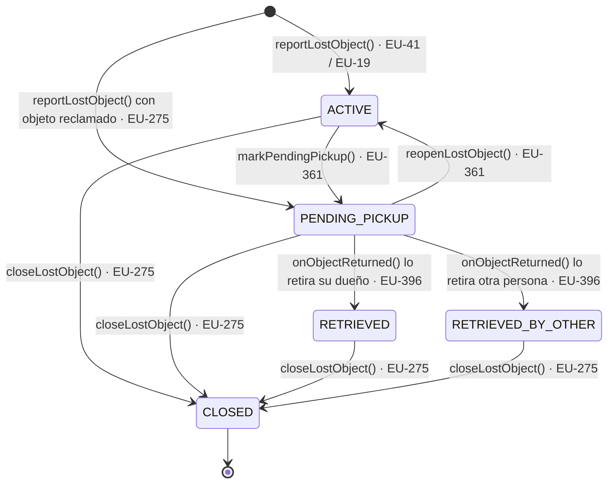
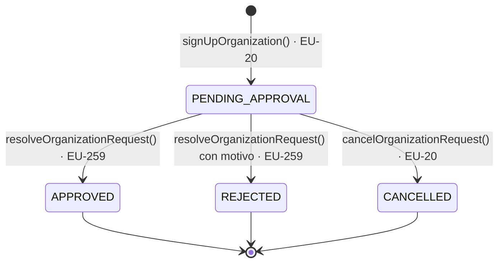
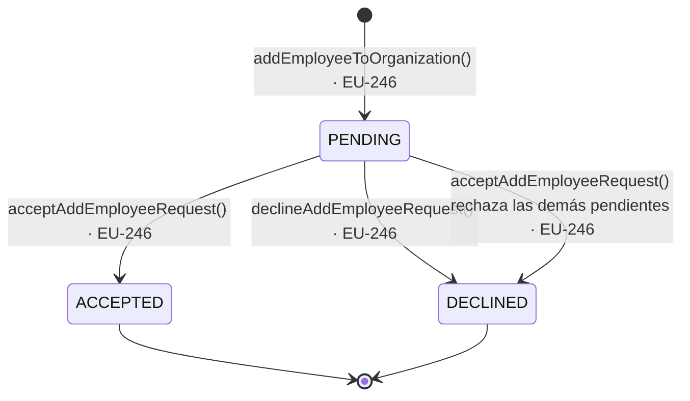
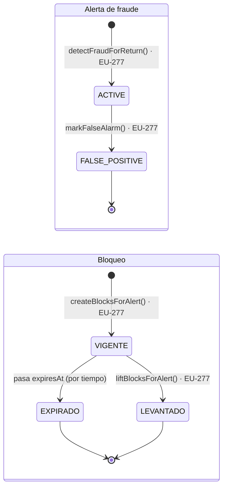
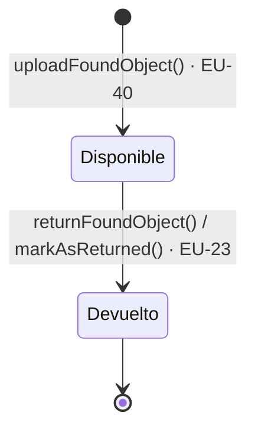
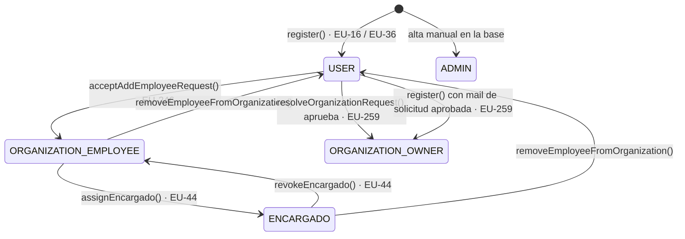
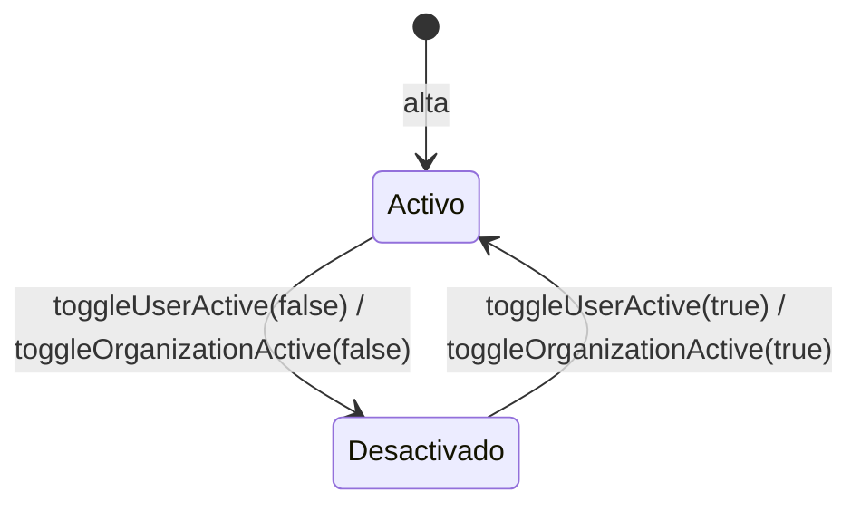

# Diagramas de transición de estados — EurekApp (EU-423)

Generado a partir del código de `Backend/src/main/java/com/eurekapp/backend/service` (estado de `main`) y de las
historias de Jira del proyecto EU. Cada entidad con ciclo de vida tiene su diagrama y una tabla que indica,
**por cada método, qué historia de usuario es responsable del cambio de estado**.

Convenciones: `[*]` es el estado inicial; una flecha a `[*]` marca un estado final. Cada transición se rotula
`método() · EU-xxx`. Cuando el cambio lo hizo una subtarea o un error, se cita la **historia padre**, que es la
que figura en el Product Backlog.

| Entidad | Campo de estado | Estados |
|---|---|---|
| Búsqueda guardada (`LostObject`) | `status` | `ACTIVE`, `PENDING_PICKUP`, `RETRIEVED`, `RETRIEVED_BY_OTHER`, `CLOSED` |
| Solicitud de alta de organización | `OrganizationRequest.status` | `PENDING_APPROVAL`, `APPROVED`, `REJECTED`, `CANCELLED` |
| Invitación a empleado | `AddEmployeeRequest.status` | `PENDING`, `ACCEPTED`, `DECLINED` |
| Alerta de fraude | `FraudAlert.status` | `ACTIVE`, `FALSE_POSITIVE` |
| Bloqueo por fraude | existencia + `expiresAt` | `VIGENTE`, `EXPIRADO`, `LEVANTADO` (derivado, no es columna) |
| Objeto encontrado (`FoundObject`) | `was_returned` | `false` (disponible), `true` (devuelto) |
| Rol de usuario | `UserEurekapp.role` | `USER`, `ORGANIZATION_EMPLOYEE`, `ENCARGADO`, `ORGANIZATION_OWNER`, `ADMIN` |
| Cuenta de usuario / organización | `active` | `activo`, `desactivado` |

---

## 1. Búsqueda guardada (`LostObject`)

- **Estado inicial:** `ACTIVE` (búsqueda guardada a mano) o `PENDING_PICKUP` (nace reclamada desde el resultado de búsqueda).
- **Estado final:** `CLOSED`. Es terminal: se rechaza reabrir (`lost_object_already_closed`).
- `RETRIEVED` y `RETRIEVED_BY_OTHER` **no son finales**: "no se cierra ninguna, eso lo decide el usuario" (EU-396).
- `markPendingPickup()` solo parte de `ACTIVE`: rechaza `CLOSED`, `PENDING_PICKUP`, `RETRIEVED`, `RETRIEVED_BY_OTHER`.
- `onObjectReturned()` lo dispara el registro de una devolución (EU-23) y solo toca búsquedas en `PENDING_PICKUP`.

| Método | Transición | Historia responsable |
|---|---|---|
| `LostObjectService.reportLostObject` | `[*]` → `ACTIVE` | **EU-41** Buscar objetos perdidos subiendo una foto de mi pertenencia; **EU-19** Búsqueda por descripción textual |
| `LostObjectService.reportLostObject` (con `matchedObjectUuid`) | `[*]` → `PENDING_PICKUP` | **EU-275** Reclamo → búsqueda guardada (quitar ciclo aprobar/rechazar) |
| `LostObjectService.markPendingPickup` | `ACTIVE` → `PENDING_PICKUP` | **EU-361** Estado "Por retirar" en las búsquedas guardadas |
| `LostObjectService.reopenLostObject` | `PENDING_PICKUP` → `ACTIVE` | **EU-361** (la vuelta atrás forma parte del estado "Por retirar") |
| `LostObjectService.onObjectReturned` | `PENDING_PICKUP` → `RETRIEVED` / `RETRIEVED_BY_OTHER` | **EU-396** La búsqueda guardada refleja que el objeto ya fue retirado |
| `LostObjectService.closeLostObject` | cualquier estado salvo `CLOSED` → `CLOSED` | **EU-275** (cierre lógico: subtarea EU-292 "Extirpar entidad Reclamo") |

---

## 2. Solicitud de alta de organización (`OrganizationRequest`)

- **Estado inicial:** `PENDING_APPROVAL`. **Estados finales:** `APPROVED`, `REJECTED`, `CANCELLED`.
- Solo se resuelve o cancela desde `PENDING_APPROVAL` (`already_resolved`, `cannot_cancel`).
- Rechazar exige `adminNote` (`admin_note_required`). Aprobar crea la `Organization` y promueve al responsable a `ORGANIZATION_OWNER` (ver §7).

| Método | Transición | Historia responsable |
|---|---|---|
| `OrganizationService.signUpOrganization` | `[*]` → `PENDING_APPROVAL` | **EU-20** Registrar solicitud de alta de organización (mejora: **EU-252**) |
| `OrganizationService.resolveOrganizationRequest` | `PENDING_APPROVAL` → `APPROVED` / `REJECTED` | **EU-259** Gestionar solicitudes de alta de organizaciones |
| `OrganizationService.cancelOrganizationRequest` | `PENDING_APPROVAL` → `CANCELLED` | **EU-20** *(a confirmar: no hay historia propia de "cancelar solicitud"; ¿EU-252?)* |

---

## 3. Invitación a empleado (`AddEmployeeRequest`)

- **Estado inicial:** `PENDING`. **Finales:** `ACCEPTED`, `DECLINED`.
- Al aceptar una invitación, las otras pendientes del mismo usuario pasan solas a `DECLINED`.
- No se puede invitar a quien ya pertenece a una organización ni repetir una invitación pendiente.

| Método | Transición | Historia responsable |
|---|---|---|
| `UserService.addEmployeeToOrganization` | `[*]` → `PENDING` | **EU-246** Enviar mail al usuario al recibir una solicitud de organización *(a confirmar: EU-246 cubre el aviso por mail; no hay otra historia de "invitar empleado")* |
| `UserService.acceptAddEmployeeRequest` | `PENDING` → `ACCEPTED`; otras `PENDING` → `DECLINED` | **EU-246** *(a confirmar)* |
| `UserService.declineAddEmployeeRequest` | `PENDING` → `DECLINED` | **EU-246** *(a confirmar)* |

---

## 4. Alerta de fraude (`FraudAlert`) y bloqueo (`FraudBlock`)

- Modelo de **2 estados**: no existe "confirmar fraude", porque la alerta **ya bloqueó al crearse**. La única acción humana es marcarla falsa alarma (EU-287, subtarea de EU-277).
- **Estado inicial de la alerta:** `ACTIVE`. **Final:** `FALSE_POSITIVE` (una alerta `ACTIVE` queda así indefinidamente si nadie la desmarca).
- El bloqueo no tiene columna de estado: está vigente mientras `expiresAt > ahora`. Marcar falsa alarma **borra** los bloqueos de esa alerta y avisa a quienes quedaron desbloqueados.
- Una alerta deduplicada (misma `dedup_key`) no se crea, así que no genera transición ni correo.

| Método | Transición | Historia responsable |
|---|---|---|
| `FraudDetectionService.detectFraudForReturn` | `[*]` → `ACTIVE` (+ crea bloqueos) | **EU-277** Detectar y limitar fraude en devoluciones (bloqueo automático); **EU-47** Detectar y notificar posibles casos de fraude |
| `FraudBlockService.createBlocksForAlert` | `[*]` → bloqueo vigente | **EU-277** |
| `FraudDetectionService.markFalseAlarm` | `ACTIVE` → `FALSE_POSITIVE` | **EU-277** (subtarea EU-287 "FALSA_ALARMA: desbloqueo + limpieza del reporte viejo") |
| `FraudBlockService.liftBlocksForAlert` | bloqueo vigente → levantado | **EU-277** (subtarea EU-287) |
| *(vencimiento de `expiresAt`)* | vigente → expirado | **EU-277**; la duración la fija **EU-339** Configurar parámetros globales de detección de fraude |

---

## 5. Objeto encontrado (`FoundObject.was_returned`)

- **Estado inicial:** disponible (`was_returned = false`). **Final:** devuelto (`true`); no hay camino de vuelta.
- Si el registro de la devolución falla a medias, `undoReturnRecord()` borra el `ReturnFoundObject` para que se pueda reintentar (**EU-408**, error).

| Método | Transición | Historia responsable |
|---|---|---|
| `FoundObjectService.uploadFoundObject` | `[*]` → disponible | **EU-40** Publicación de foto y textual de objeto encontrado; **EU-110** Publicar foto y título textual |
| `ReturnFoundObjectService.returnFoundObject` → `FoundObjectRepository.markAsReturned` | disponible → devuelto | **EU-23** Registro de devolución de un objeto encontrado |

---

## 6. Rol del usuario (`UserEurekapp.role`)

- `ADMIN` no se alcanza por ningún método de la aplicación: es una cuenta que se da de alta directamente en la base.
- `ORGANIZATION_OWNER` se asigna al aprobar una solicitud (`OrganizationService`, línea 262) o al registrarse alguien cuyo mail ya figura en una solicitud aprobada (`AuthService`, líneas 140 y 226).
- No hay método que degrade a un `ORGANIZATION_OWNER`.

| Método | Transición | Historia responsable |
|---|---|---|
| `AuthService.register` / `socialLogin` | `[*]` → `USER` (u `ORGANIZATION_OWNER`) | **EU-16** Registrar alta de nuevos usuarios; **EU-36** Registrarse utilizando Google |
| `UserService.acceptAddEmployeeRequest` | `USER` → `ORGANIZATION_EMPLOYEE` | **EU-246** *(a confirmar)* |
| `UserService.removeEmployeeFromOrganization` | `ORGANIZATION_EMPLOYEE`/`ENCARGADO` → `USER` | *(sin historia identificada: a confirmar)* |
| `UserService.assignEncargado` | `ORGANIZATION_EMPLOYEE` → `ENCARGADO` | **EU-44** Asignar el rol de encargado a las personas que correspondan |
| `UserService.revokeEncargado` | `ENCARGADO` → `ORGANIZATION_EMPLOYEE` | **EU-44** |
| `OrganizationService.resolveOrganizationRequest` | `USER` → `ORGANIZATION_OWNER` | **EU-259** Gestionar solicitudes de alta de organizaciones |

---

## 7. Activación de cuentas y organizaciones (`active`)

| Método | Transición | Historia responsable |
|---|---|---|
| `AdminService.toggleUserActive` | usuario activo ⇄ desactivado | **EU-261** Gestión de usuarios del sistema |
| `AdminService.toggleOrganizationActive` | organización activa ⇄ desactivada | **EU-262** Gestión de organizaciones activas |

No tienen estado final: la desactivación es reversible. Un usuario desactivado queda con la cuenta bloqueada
(`isAccountNonLocked()` devuelve `active`).

---

## Pendientes de confirmar con el equipo

Estas asignaciones son las únicas que no pude atar a una historia con certeza; el resto sale del código (comentarios con el número de ticket) o de Jira:

1. **Cancelar solicitud de organización:** no hay historia propia. Lo asigné a EU-20.
2. **Invitar, aceptar y rechazar empleado, y quitar empleado:** EU-246 solo habla del correo. No encontré en Jira una historia de "invitar empleado".
3. **Alta del `ADMIN`:** es manual, no hay historia.
4. **`reopenLostObject`:** lo asigné a EU-361 porque es la vuelta atrás del estado "Por retirar"; el código no cita ticket.
